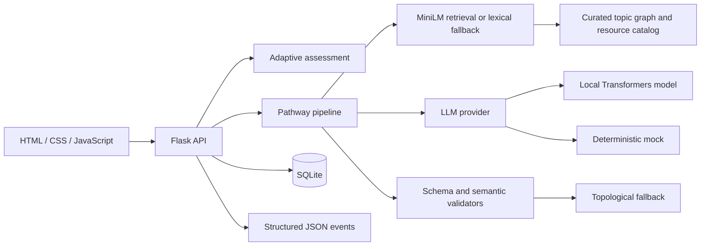

# Learning Pathway Generator

A small Flask application that checks a learner's current understanding and builds an adaptive, explainable learning roadmap. It supports Python, Data Structures & Algorithms, Machine Learning basics, and Web Development.

The pathway generator uses a curated prerequisite graph and resource catalog. Generated topic IDs and links are validated before the app returns them. If local model output cannot be repaired, an algorithmic topological fallback produces a usable plan.

## Features

- Short adaptive multiple-choice assessment with per-topic mastery estimates.
- Roadmaps with ordered topics, hours, practice tasks, checkpoints, and catalog resources.
- Local Hugging Face inference (default: `Qwen/Qwen2.5-1.5B-Instruct`) with no paid API key.
- Deterministic mock provider and lexical retrieval fallback for offline tests.
- Schema and semantic validation, up to two repair attempts, and deterministic fallback.
- SQLite persistence, request IDs, JSON observability events, and a generation transparency panel.
- Fixed 20-profile evaluation harness and CI coverage gate for assessment, knowledge, and pipeline.

## Architecture



Core domain code lives in `app/assessment`, `app/knowledge`, `app/retrieval`, `app/llm`, and `app/pipeline`. Routes provide request validation and persistence; the browser uses plain JavaScript and Jinja templates.

## Agent-facing functions

The core capabilities are directly callable with typed inputs and outputs; each function docstring states its bounds for an agent or service caller.

| Function | Module | Contract |
|---|---|---|
| `assess_level` | `app.assessment.engine` | Turn a subject mastery vector into a full per-topic report and overall level. |
| `get_topic_graph` | `app.knowledge.loader` | Return a validated curated graph for one supported subject. |
| `retrieve_resources` | `app.retrieval.service` | Return ranked topic/resource candidates from the local allowlist. |
| `generate_pathway` | `app.pipeline.generator` | Generate and validate a pathway with bounded repair and fallback. |
| `validate_pathway` | `app.pipeline.generator` | Return semantic validation errors for a pathway candidate. |

These names use direct action verbs and return machine-readable schemas so callers can compose them without depending on Flask routes. An MCP wrapper is left as optional future work.

## Setup

Python 3.11 or newer is required. From PowerShell:

```powershell
py -3.11 -m venv .venv
.\.venv\Scripts\Activate.ps1
python -m pip install -r requirements-dev.txt
```

Run tests and the app with the mock provider first:

```powershell
$env:LLM_PROVIDER = "mock"
python -m flask --app app run
```

Open <http://127.0.0.1:5000>. The mock provider is deterministic and does not load model weights. With no mock response configured, the demo safely uses the deterministic fallback.

To enable local model inference and sentence-transformer embeddings, install the optional inference dependencies:

```powershell
python -m pip install -r requirements-inference.txt
$env:LLM_PROVIDER = "local"
$env:LLM_MODEL = "Qwen/Qwen2.5-1.5B-Instruct"
$env:EMBEDDING_MODEL = "sentence-transformers/all-MiniLM-L6-v2"
python -m flask --app app run
```

The first local run may download model weights and needs network access. Inference runs on CPU and can take time; it requires no paid API key. If Transformers or embedding weights are missing, pathway generation and retrieval use their documented fallbacks. Copy `.env.example` as a reference for local environment settings; the app reads these values from process environment variables.

## API

| Method | Path | Purpose |
|---|---|---|
| `POST` | `/api/assessment/start` | Start a quiz with `{"subject":"python"}`. |
| `POST` | `/api/assessment/answer` | Submit `session_id`, `question_id`, and `selected_index`. |
| `POST` | `/api/pathway/generate` | Generate from `subject`, `goal`, `mastery`, and `budget_hours`. |
| `GET` | `/api/pathway/<id>` | Retrieve a saved pathway and provenance. |
| `GET` | `/api/health` | Check API and SQLite health without loading models. |

API input is validated with Pydantic. Errors use an `error` object with a stable code and message. Requests are capped at 32 KB, and free-text goals at 500 characters. Assessment answer keys remain on the server.

## Tests and evaluation

```powershell
python -m ruff check .
python -m pytest
python -m pytest --cov=app.assessment --cov=app.knowledge --cov=app.pipeline --cov-report=term-missing
```

The fixed-profile evaluation compares prompt versions with deterministic cases for valid output, malformed JSON, invented topics, repair, and fallback:

```powershell
python -m app.eval.run --provider mock --prompts pathway_v1 pathway_v2 --output eval/results/baseline_mock.json
```

To run a local model comparison on a machine with inference dependencies installed:

```powershell
python -m app.eval.run --provider local --models Qwen/Qwen2.5-1.5B-Instruct --prompts pathway_v1 pathway_v2
```

Read [`docs/EVAL.md`](docs/EVAL.md) for the recorded run, metrics, and limitations. Mock metrics measure pipeline robustness, not model quality.

## Design decisions and limits

- [`docs/SPEC.md`](docs/SPEC.md) is the source of truth for contracts, algorithms, failure handling, and milestones.
- [`docs/DECISIONS.md`](docs/DECISIONS.md) records the important architecture choices.
- Quiz mastery is a lightweight diagnostic estimate, not a calibrated psychometric score. The initial bank uses curated topic descriptions and should grow into authored conceptual questions.
- Curated catalogs reduce hallucinations but currently use one stable general reference per topic in several subjects; resources are not deeply ranked by pedagogy.
- Embedding retrieval depends on local weights. If loading or encoding fails, lexical retrieval ranks the same allowlisted documents.
- Local CPU inference may be slow, and small models may return invalid output; validation and fallback are part of the expected path.
- Assessment sessions are held in process memory and do not survive a server restart. SQLite stores completed pathways.
- The app is a portfolio demo, not a multi-user production service. It has no accounts, rate limiting, or remote deployment configuration.

## Future work

- Add question-writing review and broader diagnostic coverage within each subject cluster.
- Run and compare real local-model evaluation results on supported hardware.
- Improve resource ranking, evaluation criteria, and pathway personalization.
- Persist assessment sessions, add rate limiting, and harden deployment settings.
- Optionally expose the typed core functions through the official MCP Python SDK.
